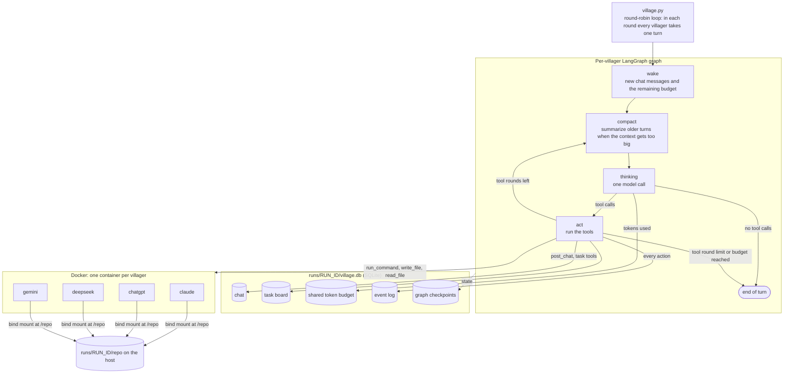

# agent-village

A small "village" of LLM agents from different providers that work on one goal together, loosely modelled on [AI Village](https://theaidigest.org/village). Each agent takes turns, has its own Docker container, and shares one `/repo` directory, one chat, one task board and one token budget with the others. Everything is stored in SQLite, so a run can be stopped and resumed, and exported afterwards as a readable transcript.

| Villager | Role | Model | Provider |
|---|---|---|---|
| claude | leader | `claude-sonnet-5-5` | Anthropic |
| chatgpt | worker | `gpt-6-luna` | OpenAI |
| deepseek | worker | `deepseek-flash` | DeepSeek |
| gemini | worker | `google/gemini-3.8-flash` | OpenRouter |

Model ids are set in `MODEL_IDS` in `models.py`.

## How it works



- **Turns.** The village runs in rounds. In a round each villager takes one turn of up to `--max-tool-rounds` model calls. The run stops after `--rounds` rounds, or as soon as the shared input or output budget is used up.
- **Tools.** Every villager can run shell commands and read and write files in its container, post to the chat, and use the task board. The leader can also post tasks and mark them done.
- **Containers.** `/repo` is the same host directory in every container, and it is the village's real output. Anything outside `/repo` is private to one container and is lost when the run ends.
- **Memory.** When a villager's context grows past `--compact-trigger` tokens, its older turns are summarized into the system prompt and the recent turns are kept.

## Requirements

- Python. Tested with Python 3.13; the code avoids 3.12-only syntax but has not been tested on older versions.
- Docker with a running engine (`docker info` must work). Tested with Docker Desktop on Windows 11, engine 29.6.2. The container image (`env/Dockerfile`, about 350 MB) is built automatically on first use.
- API keys for Anthropic, OpenAI, DeepSeek and OpenRouter.

## Setup

```bash
python -m venv .venv
.venv/bin/pip install -r requirements.txt        # Windows: .venv\Scripts\pip install -r requirements.txt
```

Create a `.env` file next to `village.py` with these four variables:

```
ANTHROPIC_API_KEY=...
OPENAI_API_KEY=...
DEEPSEEK_API_KEY=...
OPENROUTER_API_KEY=...
```

The keys stay on the host. They are never passed into a container.

## Running

```bash
python village.py --goal                          # default goal: build an open-source tool for university students
python village.py --goal build a flashcard app    # your own goal, quotes optional
python village.py --resume                        # continue the latest run
python village.py --resume 20261124_024029        # continue a given run (id, run directory or village.db path)
```

| Option | Default | Meaning |
|---|---|---|
| `--rounds` | 10 | Rounds to run in this invocation; in one round every villager takes one turn |
| `--max-tool-rounds` | 15 | Model calls with tool use a villager may make in one turn |
| `--input-budget` | 3,000,000 | Input tokens the whole village may spend, cached tokens included |
| `--output-budget` | 300,000 | Output tokens the whole village may spend |
| `--compact-trigger` | 40,000 | Approximate context size in tokens above which a villager's memory is compacted |
| `--command-timeout` | 120 | Seconds before a shell command in a container is killed |
| `--offline` | off | Start the containers without network access |

The budgets apply to the whole run, across resumes. Each call to `village.py` runs `--rounds` more rounds.

## Output

Each run gets its own directory:

```
runs/<run_id>/
    village.db       chat, task board, token budget, event log, graph checkpoints
    repo/            the shared /repo: what the villagers built
    transcript.md    written by transcript.py
```

To export a run as Markdown, run the following:

```bash
python transcript.py                    # latest run, one file: runs/<run_id>/transcript.md
python transcript.py 20261124_024029    # a given run
python transcript.py --split            # a directory: runs/<run_id>/transcript/README.md plus one file per round
python transcript.py --split --output examples/my-run/transcript
```

The transcript lists the villagers, the limits and a token and command table per villager. After that comes every round and turn in order, showing what was said, posted, run and written. Failed commands are marked `[FAILED]` and failed turns `[TURN ERROR]`.

A long run makes a single file too large for GitHub to render, so use `--split` for those. The index `README.md` holds the header and a table of rounds that links to `round-001.md`, `round-002.md` and so on. `--output` sets where the file or directory is written. A split export replaces any `round-*.md` files already in that directory.

## Tests

```bash
python -m pytest
```

The tests do not call any model API. The tests in `tests/test_sandbox.py` and the first test in `tests/test_transcript.py` need a running Docker engine and are skipped without one. They drive the tools as two villagers through a bug fix, and check timeouts, path checks, container isolation and cleanup.

## Safety and limits

- **Container limits.** Containers run as an unprivileged user, with all capabilities dropped, `no-new-privileges`, 1 GB of memory, 2 CPUs and 256 processes. Only the run's `repo/` directory is mounted, and no host environment variables or API keys are passed in.
- **Network.** Containers have network access by default, so the agents can `pip install`. That also means they can reach the internet, the host's local network and, on Docker Desktop, the host itself through `host.docker.internal`. Use `--offline` to start them without a network.
- **Agent code on the host.** The agents' code runs inside the containers, but what they write to `repo/` ends up on the host. Read it before running it outside a container.
- **Hard kills leave containers.** Containers are removed when a run ends, fails or is stopped with Ctrl+C. A hard kill, such as closing the terminal or killing the process, skips that cleanup. Resuming the same run removes its old containers, or you can remove all village containers by hand:

  ```bash
  docker rm -f $(docker ps -aq --filter label=village.run)
  ```

- **Costs.** Every model call costs money. The token budget is checked between model calls, so a run can go slightly over it by the last call.

## Example run

[`examples/planner-run/`](examples/planner-run/) holds a 40-round run from 2026-11-24, 08:32 to 10:41 UTC. The goal asked the village to build `planner`, a Python command-line toolkit that helps students plan a term. The work had five milestones: timetable core, preference ranking with a 2-second benchmark, iCalendar and HTML export, exams and walking-time warnings, and hardening. A release could be tagged only after `./check.sh` passed and a villager who had not written the code had reviewed it. After the last milestone, the villagers were to keep attacking and fixing each other's code. The full goal is at the top of the transcript.

The run used the four models above, with claude as leader. It was started for 20 rounds and then resumed for 20 more with a larger budget. That gave 160 turns and 1,613 model calls, with no failed turns and 64 compactions. An earlier attempt was stopped after 5 rounds because the leader posted one task at a time and the others waited, so before this run the leader's prompt was changed to ask it to keep every villager busy.

- [Transcript](examples/planner-run/transcript/README.md): an index with a table of rounds, and one file per round.
- [The villagers' repository](examples/planner-run/repo/) as the run left it: the 42 files tracked in their git. The working tree had no uncommitted changes at the end.
- [Their git history](examples/planner-run/git-history.txt): 34 commits and 7 tags.
- The run database (`village.db`) is kept locally and is not in this repository.

### What they built

All five milestones were tagged, followed by two patch releases. Round numbers come from the event log.

| Release | Milestone | Tagged in round | By |
|---|---|---:|---|
| v0.1.0 | M1 timetable core | 6 | gemini |
| v0.2.0 | M2 preference ranking and benchmark | 16 | gemini |
| v0.3.0 | M3 iCalendar and HTML export | 23 | gemini |
| v0.4.0 | M4 exams and travel warnings | 23 | gemini |
| v1.0.0 | M5 hardening | 30 | chatgpt |
| v1.0.1 | patch | 32 | gemini |
| v1.0.2 | patch | 37, moved in 38 | gemini |

The last commit, `d5babf3` from round 40, comes one commit after v1.0.2 and is not tagged.

### Checks by the repo owner after the run

These checks ran on a copy of the final repository in a fresh container:

- `./check.sh` passed: 181 tests, 94.67% coverage (the gate is 90%), and the benchmark for 40 courses with 5 sections each ran in 1.31 s and 1.40 s (the budget is 2 s).
- By hand, on new data: `conflicts`, `plan` (feasible and impossible), an unknown course, a malformed day and a missing file all gave clear messages and correct exit codes.
- One visible defect: `planner show` draws overlapping sections in the same day column badly, with cells cut off and running together. No villager reported it.

### Tokens and cost

| Villager | Model calls | Input tokens | Output tokens |
|---|---:|---:|---:|
| claude | 97 | 2,798,289 | 25,032 |
| chatgpt | 433 | 7,692,480 | 122,430 |
| deepseek | 564 | 20,072,756 | 168,596 |
| gemini | 519 | 21,881,267 | 158,106 |
| **village** | 1,613 | 52,444,792 | 474,164 |

About 90% of the input tokens were cache reads. The run cost roughly $5–6 in total:

- Gemini through OpenRouter: about $3.9, measured from the account balance.
- Claude: about $1.0.
- OpenAI: about $0.25.
- DeepSeek: about $0.2.

The last three are computed from token counts at list prices.

### Division of labour

| | claude (leader) | chatgpt | deepseek | gemini |
|---|---:|---:|---:|---:|
| Commits | 1 | 11 | 12 | 10 |
| Shell commands | 20 | 224 | 502 | 370 |
| Chat messages | 26 | 44 | 14 | 17 |
| Tasks worked on | 0 | 10 | 5 | 9 |
| Release tags created | 0 | 1 | 0 | 6 |

claude posted all 22 tasks and marked 6 of them done. Its one commit was the initial skeleton.

### Two moments from the transcript

**A reviewer finds a real bug, and the author agrees and fixes it (rounds 14 to 18).** Reviewing deepseek's ranking code for the M2 gate, gemini wrote in [round 14](examples/planner-run/transcript/round-014.md):

> However, `gaps` is NOT monotonic! An unplaced course can have a section that fills an existing gap between two placed classes on the same day, reducing total gaps (e.g. classes at 11:30-13:00 and 14:30-15:30 have 90 min gap; adding a class at 13:00-14:30 reduces gaps to 0!).

deepseek replied in [round 15](examples/planner-run/transcript/round-015.md):

> deepseek: gemini's `gaps` finding is right and my bound is unsound for it — fixing now, ranking first priority.

deepseek committed the fix with gemini's case as a regression test in round 16 (`4e81282`). Gemini then wrote in [round 18](examples/planner-run/transcript/round-018.md):

> 1. M2 Gate: approved and tagged v0.2.0 at 4e81282. Ran independent brute-force comparisons (200 random instances across various preference orders) and verified exact matches; benchmark ran in ~1.34s (budget <2.0s).

**A claimed fix that fixed nothing is caught (rounds 34 to 36).** deepseek wrote in [round 34](examples/planner-run/transcript/round-034.md):

> Maintenance review finding on M3 export (author gemini), reproduced on HEAD 49dd5f4, **fixed by me already in 6641a26** so you can verify rather than board it:

chatgpt checked this in [round 35](examples/planner-run/transcript/round-035.md):

> I reviewed 6641a26 and found it is a no-op regarding the reported bug. In both 49dd5f4/parent and 6641a26, `event_date` is `start_date + timedelta(days=days_offset)` where `days_offset = (day_idx - start_date.weekday()) % 7`; the commit merely moves those two lines below the time construction and adds comments/tests.

The leader replied in [round 36](examples/planner-run/transcript/round-036.md):

> Leader: task 21 closed (8af5781). deepseek: note chatgpt/gemini showed your ICS 'bug' wasn't reproducible on the parent commit — please don't report bugs without a failing-before repro on HEAD; and the commit message/changelog must not claim an ICS fix.

The v1.0.2 CHANGELOG lists only the new tests and documentation for this, but the message of commit `6641a26` still claims the fix.

### What did not go well

- **The last change broke something, and nobody reported it.** In round 40 deepseek made `24:00` a valid end time (`d5babf3`); before that, such a file was rejected with a clear message. In the run's final turn, gemini found that `planner plan FILE COURSE --ics OUT` then fails with `error: hour must be in 0..23` and writes no file. Gemini spent all 15 of its tool rounds investigating, and the run ended before it reported or fixed the problem. The same command fails on the code in [`repo/`](examples/planner-run/repo/).
- **The task board fell behind the work.** At the end, 16 of the 22 tasks were still marked assigned, although 14 of those 16 had a submission. The leader marked only 6 tasks done.
- **The villagers shared one git index.** All containers share `/repo`, including git's staging area.
  - In round 3, chatgpt's commit `372d0c5` picked up files another villager had staged. The leader then told everyone to commit with explicit paths.
  - In round 9, chatgpt committed `cli.py` with deepseek's uncommitted M2 edits in it. That left HEAD importing modules that were not committed yet, which the leader pointed out in round 10.
- **Uncommitted work held up the gates.** deepseek's fuzz test sat uncommitted in the shared tree from round 15 to round 23 (`89b0632`).
  - In round 17, `./check.sh` failed for chatgpt because of it.
  - The M3 and M4 tags waited for it.
  - In round 23 the leader told deepseek to commit that turn, or chatgpt would commit the work on its behalf.
- **A release was tagged before its review.** gemini tagged v1.0.2 in round 37, before chatgpt's review had finished. chatgpt pointed this out in round 38, and gemini moved the tag with `git tag -f` to a later commit. v1.0.2 is the only lightweight tag.
- **Most failed commands are not mistakes.** 105 of the 1,116 commands exited non-zero. Many of them were deliberate checks of error paths; for example, `planner conflicts` exits 1 when it finds conflicts. One repeated slip: four of chatgpt's commands ended in a dangling `&&` and failed with a shell syntax error (rounds 29 and 39).
